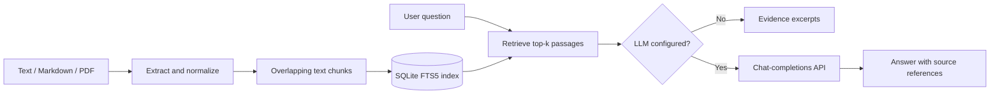

# RAG Workflow Agent

[](https://www.python.org/)  

A **local-first, inspectable retrieval-augmented generation (RAG) service** for document question answering. It has a working lexical retrieval baseline, transparent workflow tracing, source passages, and optional generation through an OpenAI-compatible endpoint.

> **Status:** engineering prototype, not a production-ready autonomous agent. Retrieval is SQLite FTS5 lexical search, not semantic embeddings. The workflow is deterministic: validate → retrieve → extract or generate. It does not execute arbitrary tools.

## Architecture



### Features

- Ingestion API with re-indexing by document source, chunk overlap, and persistent SQLite storage.
- BM25-ranked **full-text retrieval** using SQLite FTS5; source text and scores are returned with each response.
- FastAPI endpoints: `GET /health`, `POST /ingest`, `POST /query`.
- A reusable, unit-testable workflow coordinator in `app/workflow.py` with step-by-step execution traces.
- CLI document loaders for `.txt` and `.md`; optional `.pdf` support using PyMuPDF.
- Optional LLM endpoint, with retrieved passages separated from a system instruction. Generation can still be wrong: validate citation accuracy.
- Dockerfile, example environment variables, and pytest tests.

## Install

```bash
git clone https://github.com/kasranonahal/rag-workflow-agent.git
cd rag-workflow-agent
python -m venv .venv
source .venv/bin/activate  # Windows PowerShell: .venv\Scripts\Activate.ps1
pip install -r requirements.txt
# For PDF import: pip install pymupdf
uvicorn app.main:app --reload
```

Open Swagger UI at `http://127.0.0.1:8000/docs`.

## Example workflow

**1. Ingest a document**

```bash
curl -X POST http://127.0.0.1:8000/ingest \
  -H "Content-Type: application/json" \
  -d '{"source":"notes.md","text":"RAG combines retrieval with language generation. The retrieval step selects relevant evidence."}'
```

Alternatively, for local files from the repository root:

```bash
python -m scripts.ingest ./notes.md
```

**2. Ask a question**

```bash
curl -X POST http://127.0.0.1:8000/query \
  -H "Content-Type: application/json" \
  -d '{"question":"What does retrieval do in RAG?","top_k":3}'
```

By default, the API returns evidence passages with their sources. Configure an LLM to generate a synthesized answer:

```bash
export LLM_BASE_URL=http://localhost:11434/v1
export LLM_MODEL=your-installed-model
export LLM_API_KEY=not-required
```

These variables are optional. Keep real API keys in environment variables, never committed files. If the model endpoint is unreachable, the API responds with a gateway error rather than claiming success.

**3. Inspect the workflow trace in Python**

```python
from app.workflow import run_retrieval
result = run_retrieval("What does retrieval do?", top_k=3)
print(result["trace"])
print(result["sources"])
```

## Run tests

```bash
pytest -q
```

## Project layout

```text
app/
  core.py        # chunker, SQLite index and ranked retrieval
  loaders.py     # TXT / Markdown / PDF extraction
  workflow.py    # traceable retrieval coordinator
  main.py        # REST API, optional LLM generation
scripts/
  ingest.py      # CLI document ingestion
tests/           # retrieval and workflow unit tests
Dockerfile
.env.example
requirements.txt
```

## Design considerations

| Concern | Current approach | Planned improvement |
|---|---|---|
| Relevance | SQLite FTS5 / BM25 | Embedding-based semantic and hybrid retrieval |
| Observability | Explicit workflow steps / source scores | Structured logging, latency metrics, evaluation |
| Grounding | Numbered source excerpts | Citation verification and answer evaluation |
| Storage | Local SQLite | Pluggable vector DB and object storage |
| Security | No hardcoded secrets; untrusted context instruction | Authentication, rate limiting, tenant isolation |
| Ingestion | Text, Markdown, optional PDF CLI | Batch uploads and asynchronous processing |

**Limitations:** This is a prototype intended for learning and extension. It does not currently implement access control, multi-user isolation, reranking, vector embeddings, or production job queues. Do not expose it publicly without additional security controls. Only ingest documents you have permission to process.

## License

No license has been added yet; all rights are reserved until one is chosen.
